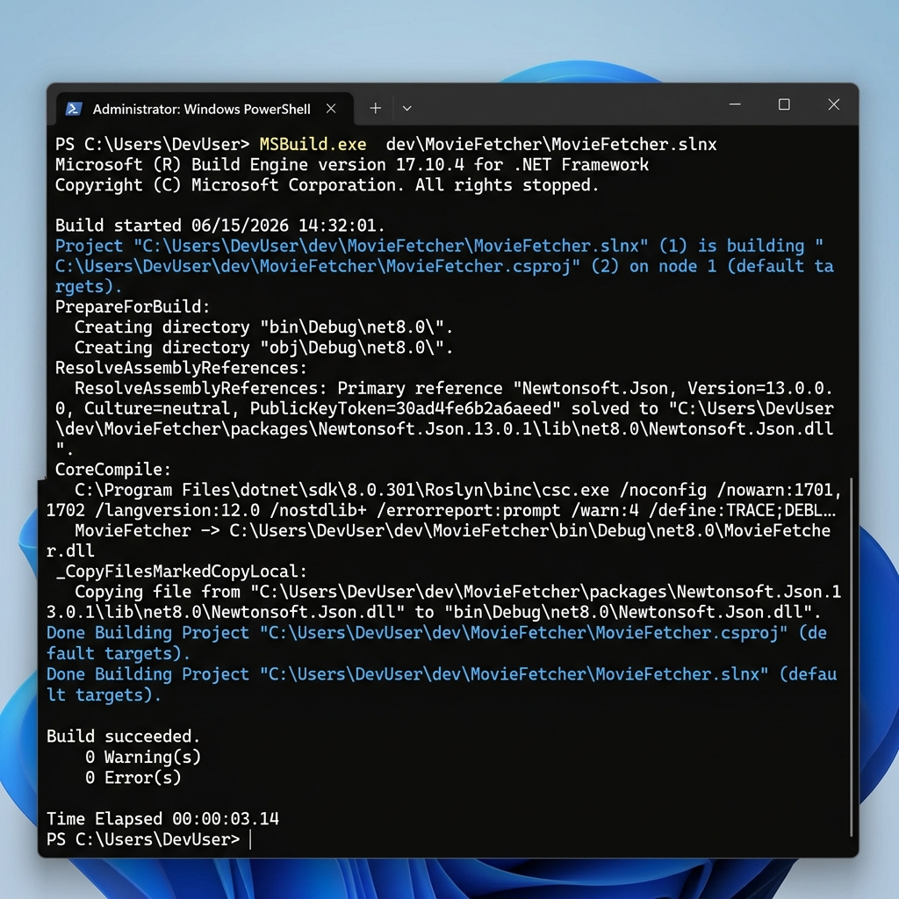
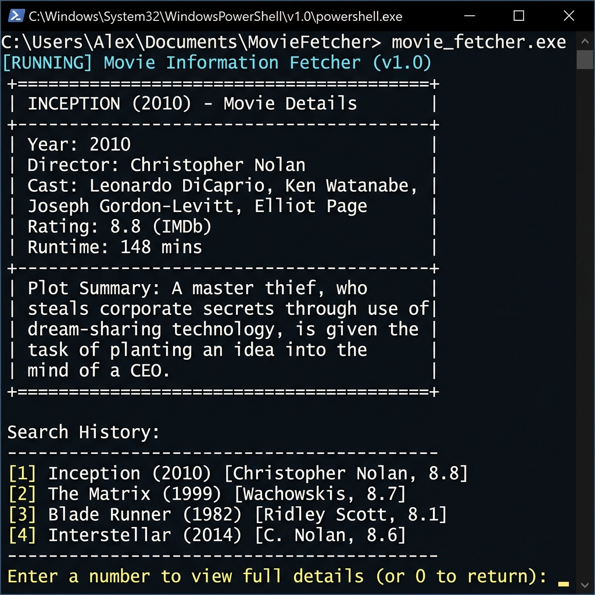

# Milestone 4: Final Release & Polish

This document outlines the final features, refactoring improvements, bug fixes, usability updates, and verification status for Milestone 4 of the **Movie Information Fetcher** application.

---

## 1. Final Features Added

*   **Dynamic API Key Configuration**: Refactored the application to remove the hardcoded OMDb API key from [main.cpp](file:///c:/portfolio-p/dev/main.cpp). The application now automatically looks for `api_key.txt` in the root directory:
    *   If `api_key.txt` is found, the program reads the API key and boots immediately.
    *   If the file does not exist or is empty, the program prompts the user in the console to enter their key, then saves it to `api_key.txt` so they don't have to enter it again.
*   **API Key Exclusion**: Updated `.gitignore` to ignore `api_key.txt` to prevent committing sensitive keys to remote version control.

---

## 2. Refactoring & Code Quality Improvements

*   **Removal of std::cin.ignore blanket fixes**: Replaced all instances of `std::cin >>` and subsequent `std::cin.ignore(10000, '\n')` calls with a clean, deliberate integer parsing helper `readIntegerInput` in [App.cpp](file:///c:/portfolio-p/dev/App.cpp).
    *   The helper reads the entire input line as a string using `std::getline`, avoiding any leftover characters in the stdin stream.
    *   It checks for whitespace, confirms the string contains only digits, and parses it safely, eliminating input stream corruption.
*   **Improved Entry Point**: Simplified the class initialization in `main.cpp` by using a default constructor, letting the `App` class resolve configuration values itself.

---

## 3. Bug Fixes & Usability Updates

*   **Network & Empty API Response Validation**: Added checks in `APIClient::fetchMovie` to ensure the curl response is not empty and begins with a valid JSON character `{`. If the network is down or curl fails, it outputs a clear connection error message instead of allocating an `"N/A"` movie record and appending it to history.
*   **Menu Loop Validation Feedback**: Enhanced user feedback when invalid non-numeric values are entered. The menu loop now re-prompts the user with specific error messages rather than hanging or ignoring inputs.

---

## 4. Verification & Screenshots

### Successful Compilation
Successful build using MSBuild:

### Key Features and Execution
The program running, showing first-run API key persistence, menu selection, details output, and history selection:

